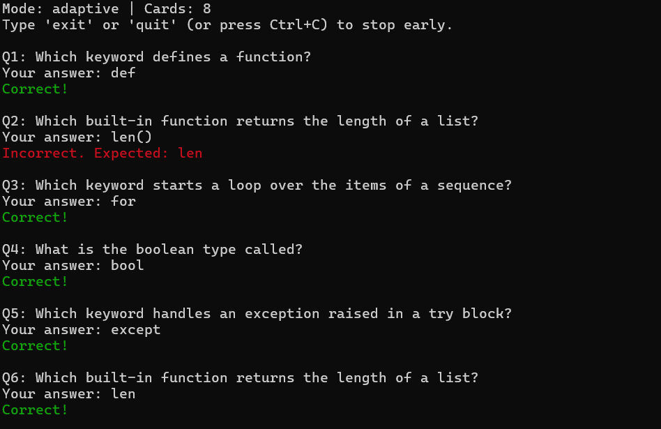
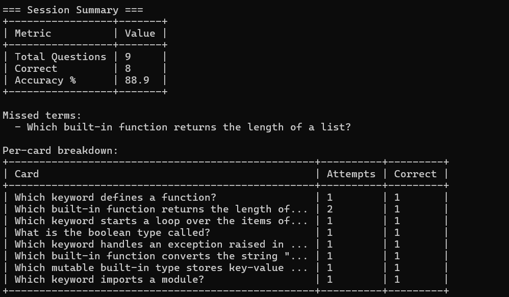

# Flashcard Quizzer

A command-line application that loads flashcards from a JSON file and quizzes
you in the terminal. Questions can be asked in deck order, in random order, or
adaptively (cards you miss come back until you get them right). When the quiz
ends you get a summary table with your accuracy and the terms you missed.

The application uses only the Python standard library. It was built with AI
assistance (Claude Code); the full story is in [docs/ai_edit_log.md](docs/ai_edit_log.md)
and [docs/report.md](docs/report.md).

## Features

- **Three quiz modes** selected with `--mode`: `sequential`, `random`,
  `adaptive` (see [Architecture](#architecture)).
- **Deck validation** with one-line, actionable errors (missing file,
  directory, empty file, invalid JSON with line and column, non-UTF-8 file,
  missing or empty field naming the card position, duplicate fronts).
- **Forgiving answer matching**: case and extra whitespace are ignored.
- **Coloured feedback** (green for correct, red for incorrect). Colours are
  switched off automatically when output is not a terminal or when the
  `NO_COLOR` environment variable is set.
- **Early exit**: type `exit` or `quit` at any prompt, press Ctrl+C, or close
  the input stream. The quiz stops and the summary is still shown. A card whose
  correct answer is literally `exit` or `quit` can still be answered.
- **Summary table** with total questions, correct answers, accuracy and the
  list of missed terms. `--stats` adds a per-card table (attempts and correct
  answers).
- **Extras**
  - `--limit N` asks only the first N cards after the mode's ordering.
  - `--seed INT` makes random mode reproducible (it only affects random mode).
  - `--history-file PATH` stores per-card miss counts between sessions, so
    adaptive mode asks previously missed cards first.
  - `--export PATH` writes the session results to a `.json` or `.csv` file.

## Requirements

- Python 3.10 or newer
- `pip` and the standard `venv` module
- No runtime dependencies. The quality tools (pytest, pytest-cov, black,
  isort, flake8, mypy, plus a few other packages from the course starter) are
  listed in `requirements.txt` and are only needed for development.

## Getting the code

```bash
git clone https://github.com/fsabatini82/flashcard-quizzer.git
cd flashcard-quizzer
```

## Installation

Windows (PowerShell or cmd):

```bash
python -m venv venv
venv\Scripts\activate
python -m pip install -r requirements.txt
```

macOS / Linux:

```bash
python3 -m venv venv
source venv/bin/activate
python -m pip install -r requirements.txt
```

You can skip the install if you only want to run the quizzer: it needs nothing
beyond the standard library.

## Usage

```bash
python main.py --file <deck.json> [--mode MODE] [options]
```

`python main.py --help` prints:

```text
usage: main.py [-h] -f FILE [-m {adaptive,random,sequential}] [--stats]
               [--limit N] [--seed INT] [--history-file PATH] [--export PATH]

Flashcard Quizzer: test yourself with flashcards from a JSON deck. Type 'exit'
or 'quit' at any prompt to stop early.

options:
  -h, --help            show this help message and exit
  -f FILE, --file FILE  path to the JSON flashcard deck
  -m {adaptive,random,sequential}, --mode {adaptive,random,sequential}
                        question order: sequential (deck order), random, or
                        adaptive (weak cards first, missed cards repeat)
                        (default: sequential)
  --stats               add a detailed per-card table (attempts and correct
                        answers) to the summary; the basic summary is always
                        shown
  --limit N             only ask the first N cards after the mode's ordering
  --seed INT            random seed for reproducible order; only affects
                        random mode (ignored in other modes)
  --history-file PATH   JSON file that stores per-card miss counts across
                        sessions; adaptive mode asks previously missed cards
                        first
  --export PATH         write the session results to PATH (.json or .csv)
```

### Options

| Flag | Description | Example |
| --- | --- | --- |
| `-f`, `--file` | Deck to load (required). | `python main.py -f data/glossary.json` |
| `-m`, `--mode` | `sequential` (default), `random` or `adaptive`; case-insensitive. | `python main.py -m random -f data/glossary.json` |
| `--stats` | Add the per-card table to the summary. | `python main.py -f data/glossary.json --stats` |
| `--limit N` | Ask at most N cards (N >= 1). | `python main.py -f data/glossary.json --limit 5` |
| `--seed INT` | Reproducible random order (random mode only). | `python main.py -m random --seed 42 -f data/glossary.json` |
| `--history-file PATH` | Load and update miss counts across sessions. | `python main.py -m adaptive -f data/git_commands.json --history-file history.json` |
| `--export PATH` | Save results as `.json` or `.csv`. | `python main.py -f data/glossary.json --export results.csv` |

### Example session

Answers were piped in for this transcript (the prompt line is blank because
the piped answers are not echoed; in a terminal you type them after
`Your answer:`). Colours are off here because output is not a terminal.

```bash
printf 'Application Programming Interface\nwrong\nCentral Processing Unit\n' | python main.py -m sequential -f data/glossary.json --limit 3 --stats
```

```text
=== Flashcard Quizzer ===
Mode: sequential | Cards: 3
Type 'exit' or 'quit' (or press Ctrl+C) to stop early.

Q1: API
Your answer: Correct!

Q2: CDN
Your answer: Incorrect. Expected: Content Delivery Network

Q3: CPU
Your answer: Correct!


=== Session Summary ===
+-----------------+-------+
| Metric          | Value |
+-----------------+-------+
| Total Questions | 3     |
| Correct         | 2     |
| Accuracy %      | 66.7  |
+-----------------+-------+

Missed terms:
  - CDN

Per-card breakdown:
+------+----------+---------+
| Card | Attempts | Correct |
+------+----------+---------+
| API  | 1        | 1       |
| CDN  | 1        | 0       |
| CPU  | 1        | 1       |
+------+----------+---------+
```

### Adaptive mode and the history file

In adaptive mode a card answered incorrectly is asked again a few questions
later (3 positions ahead, or at the end if fewer cards remain) until you answer
it correctly. A card answered correctly is never repeated within a session.

With `--history-file`, miss counts persist between sessions: each wrong answer
adds one miss, and a card answered correctly (and never missed in that session)
loses one. Cards with the most misses are asked first next time. A history
file that does not exist yet is created at the end of the first session. A
corrupt history file is ignored with a warning and is never overwritten.

First session (answers: wrong, then three correct):

```bash
printf 'wrong\ngit clone\ngit status\ngit init\n' | python main.py -m adaptive -f data/git_commands.json --limit 3 --history-file history.json
```

```text
Q1: Which command creates a new local repository?
Your answer: Incorrect. Expected: git init
Q2: Which command copies a remote repository to your machine?
Your answer: Correct!
Q3: Which command shows modified and staged files?
Your answer: Correct!
Q4: Which command creates a new local repository?
Your answer: Correct!
(summary: 4 questions, 3 correct, 75.0 %, missed term: the `git init` card)
```

`history.json` now contains
`{"version": 1, "miss_counts": {"Which command creates a new local repository?": 1}}`.
In a second session that card is asked first; answering it correctly lowers its
count back to zero and the entry is dropped.

### Exporting results

```bash
python main.py -f data/git_commands.json --limit 1 --export results.csv
```

CSV columns are `question,front,user_answer,correct`. For example:

```text
question,front,user_answer,correct
1,Which command creates a new local repository?,git init,yes
```

A `.json` export contains `summary` (totals, accuracy, missed terms),
`per_card` (attempts and correct counts) and `answers` (every answer in order).
The export path is validated before the quiz starts, so a bad path fails
immediately instead of after the last question. Files are written atomically
(temporary file, then replace). CSV cells that start with `=`, `+`, `-`, `@`,
a tab or a carriage return are prefixed with `'` so spreadsheets do not treat
them as formulas.

### Exit codes

| Code | Meaning |
| --- | --- |
| 0 | Quiz finished or stopped early |
| 1 | Deck could not be loaded, or the export path or export write failed |
| 2 | Invalid command-line arguments (argparse) |
| 130 | Ctrl+C pressed outside a question (while loading, printing the summary or saving); prints `Interrupted.` with no traceback |

## Deck format

Two layouts are accepted. Every card needs a non-empty string `front` (the
prompt) and `back` (the expected answer). Fronts must be unique, ignoring case.
Values are stripped of surrounding whitespace.

Array of cards (`data/glossary.json`):

```json
[
  {"front": "API", "back": "Application Programming Interface"},
  {"front": "CDN", "back": "Content Delivery Network"}
]
```

Object with a `cards` array (`data/python_basics.json`):

```json
{
  "cards": [
    {"front": "Which keyword defines a function?", "back": "def"}
  ]
}
```

### Error messages for bad decks

Errors go to stderr as one line starting with `Error:` and the program exits
with code 1. No traceback is shown.

| Problem | Message |
| --- | --- |
| File does not exist | `Error: File not found: 'nope.json'.` |
| Path is a directory | `Error: 'data' is a directory, not a file.` |
| Empty file | `Error: File '<path>' is empty.` |
| Invalid JSON | `Error: Invalid JSON in '<path>' at line 1, column 29: Expecting property name enclosed in double quotes.` |
| Not UTF-8 | `Error: '<path>' is not valid UTF-8 text (invalid start byte).` |
| Top-level object without `cards` | `Error: Top-level object must contain a 'cards' array.` |
| No cards | `Error: The deck contains no cards.` |
| Missing field | `Error: Card #1 is missing required field 'back'.` |
| Empty field | `Error: Card #1 field 'back' is empty.` |
| Duplicate front | `Error: Card #2 has a duplicate front 'A' (same as card #1).` |
| Unsupported export extension | `Error: Unsupported export format '.txt'. Use one of: .json, .csv.` |
| Export folder missing | `Error: Export directory 'nodir' does not exist.` |

A card with a field of the wrong type reports, for example,
`Card #1 field 'back' must be a string (found int).`

### Bundled decks

| Deck | Format | Cards | Topic |
| --- | --- | --- | --- |
| `data/glossary.json` | array | 10 | Common tech acronyms (API, CDN, CPU, ...) |
| `data/python_basics.json` | object | 8 | Python keywords and built-ins |
| `data/server_acronyms.json` | array | 14 | Networking and server acronyms (SSH, TLS, DHCP, ...) |
| `data/git_commands.json` | object | 13 | Git commands |

## Project structure

```text
starter/
├── main.py                 # CLI entry point: argparse and wiring only
├── data_loader.py          # Flashcard dataclass, deck validation and loading
├── quiz_engine.py          # QuizMode strategies, create_mode factory, QuizSession
├── ui.py                   # QuizUI: prompts, feedback, summary tables, colours
├── utils/
│   ├── file_handler.py     # Safe JSON reading, atomic writing, friendly errors
│   ├── history.py          # Miss-count persistence for adaptive mode
│   └── exporter.py         # JSON/CSV export of session results
├── data/                   # Bundled decks
├── tests/                  # pytest suite (271 tests)
├── docs/
│   ├── ai_edit_log.md      # Log of AI interactions and reviews
│   ├── report.md           # Final project report
│   ├── report_template.md  # Report template provided with the course
│   ├── architecture.md     # Diagrams and design decisions
│   ├── coverage_report.txt # Output of the coverage run
│   └── design_patterns.md  # Pattern reference provided with the course
├── ai_guidance/            # Prompting and code review guides (course material)
├── .claude/                # Claude Code configuration (course material)
├── pyproject.toml          # black, isort, mypy and pytest configuration
├── .flake8, .coveragerc    # flake8 and coverage configuration
└── requirements.txt        # Development tools
```

## Architecture

The code is split so that the quiz logic never touches the terminal:

- `quiz_engine.py` has no I/O. A `QuizSession` serves cards from a `QuizMode`
  and scores answers.
- `ui.py` owns all console input and output, and its input and output functions
  can be injected, so tests run without a terminal.
- `main.py` only parses arguments and connects the pieces.

Two design patterns do real work here:

- **Strategy**: `QuizMode` is an abstract base class that decides which card is
  asked next. `SequentialMode`, `RandomMode` and `AdaptiveMode` are the
  interchangeable strategies; `QuizSession` does not know which one it uses.
- **Factory**: `create_mode(name, cards, ...)` looks the name up in a registry
  (`_MODE_REGISTRY`), builds the mode and applies `--limit`. Unknown names raise
  a `ValueError` that lists the valid choices.

See [docs/architecture.md](docs/architecture.md) for diagrams and design notes.

### Adding a new mode

Add a subclass and one registry entry, both in `quiz_engine.py`. Nothing else
changes: `AVAILABLE_MODES` is derived from the registry, so the new name
appears in `--mode` and `--help` automatically.

```python
class ReverseMode(_QueueMode):
    """Ask every card once, starting from the end of the deck."""

    @property
    def name(self) -> str:
        return "reverse"

    def _initial_order(self, cards: Sequence[Flashcard]) -> list[Flashcard]:
        return list(reversed(cards))


_MODE_REGISTRY: dict[str, type[QuizMode]] = {
    "sequential": SequentialMode,
    "random": RandomMode,
    "adaptive": AdaptiveMode,
    "reverse": ReverseMode,  # <- the one new line
}
```

`_QueueMode` is the shared base that keeps cards in a queue and already
implements `next_card()` and `limit_to()`. A mode that needs a different
structure can subclass `QuizMode` directly and implement `name`, `next_card()`
and `limit_to()`; it may also override `record_result()` (used by adaptive
mode to re-queue missed cards) and the `create()` classmethod (to receive
`rng` or `miss_counts` from the factory). A test registers a throwaway mode
this way to show that the factory needs no change
(`test_new_mode_can_be_added_without_touching_the_factory` in
`tests/test_quiz_modes.py`).

## Development

Run everything from this folder with the virtual environment active.

```bash
python -m pytest                                  # run the 271 tests
python -m pytest --cov=. --cov-report=html        # coverage, HTML report in htmlcov/
python -m pytest --cov=. --cov-report=term-missing  # coverage in the terminal
python -m black --check .                         # formatting (drop --check to apply)
python -m isort --check-only .                    # import order (drop --check-only to apply)
python -m flake8 .                                # lint
python -m mypy .                                  # strict type checking
```

Current results: 271 tests passed, 100% line coverage (516 statements), and
black, isort, flake8 and mypy (`strict = true`) report no issues. The coverage
output is saved in [docs/coverage_report.txt](docs/coverage_report.txt), and a
screenshot of the HTML report is in [docs/coverage_report.png](docs/coverage_report.png).
Configuration lives in `pyproject.toml`, `.flake8` and `.coveragerc`.

The tests use only `tmp_path`, `monkeypatch` and `capsys`; none reads the real
standard input. Ctrl+C and end-of-input handling are covered by unit tests that
simulate `KeyboardInterrupt` and `EOFError`. I also played a full adaptive session
by hand in Windows Terminal to check colours, repeated cards and the summary:





## Documentation

| Document | Contents |
| --- | --- |
| [docs/ai_edit_log.md](docs/ai_edit_log.md) | Seven logged AI interactions with prompts, reviews, changes and lessons |
| [docs/report.md](docs/report.md) | Final project report |
| [docs/architecture.md](docs/architecture.md) | Module, class and sequence diagrams; design decisions |
| [docs/coverage_report.txt](docs/coverage_report.txt) | Coverage run output |

## License

Course project. See the course repository for the licence terms.
