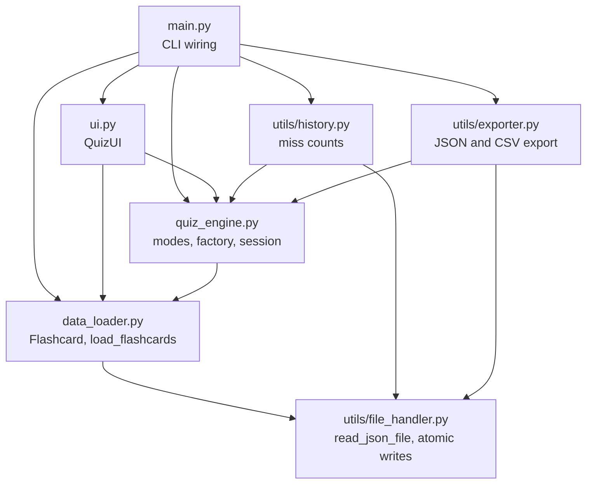
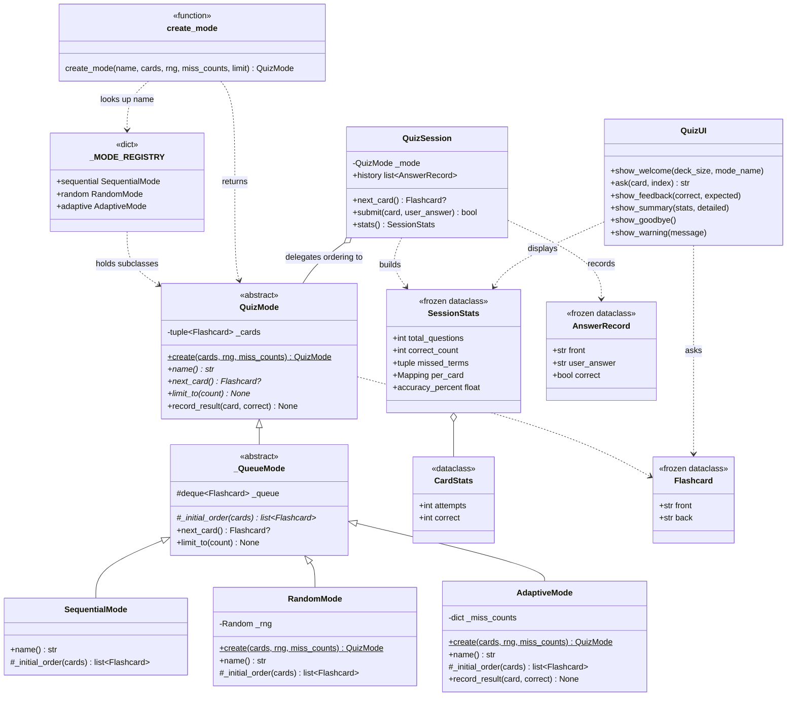
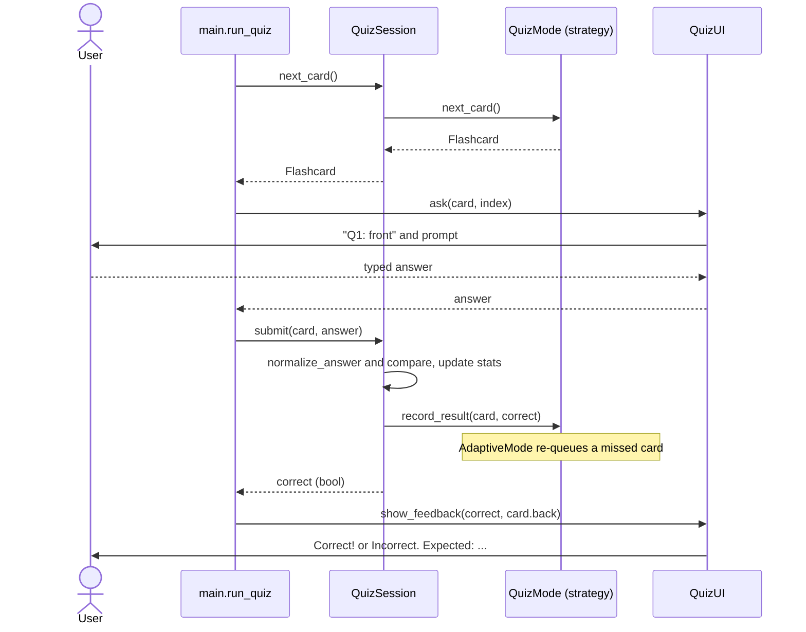
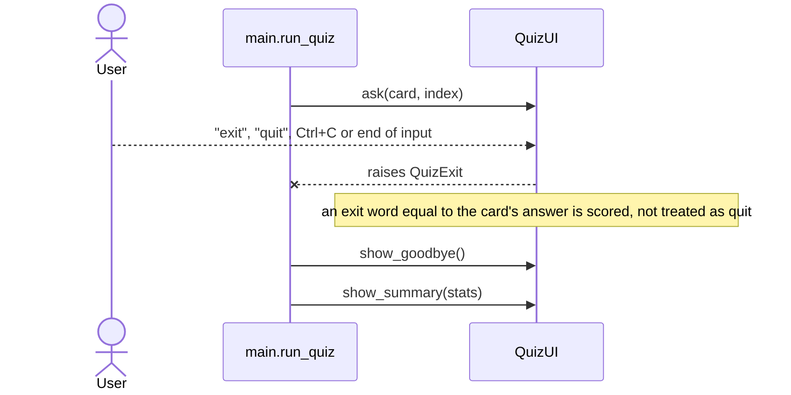

# Architecture

This document describes how the Flashcard Quizzer is organised. The diagrams
are written in [Mermaid](https://mermaid.js.org/) and render on GitHub and in
most Markdown viewers. Names in the diagrams match the code in the repository
root; see the [README](../README.md) for usage.

## 1. Module dependencies

Arrows point from the importing module to the module it imports. There are no
circular imports and the domain layer (`quiz_engine`, `data_loader`) never
imports the UI.

`ui.py` imports `normalize_answer` and `SessionStats` from `quiz_engine`, and
`utils/history.py` and `utils/exporter.py` import `SessionStats` (and
`AnswerRecord`) from it. These helper-to-domain dependencies are intentional but
are listed under [known trade-offs](#5-known-trade-offs).

## 2. Module responsibilities

| Module | Responsibility | Depends on |
| --- | --- | --- |
| `main.py` | Parse arguments, load the deck, build the mode and session, run the question loop, save history and export | all other modules |
| `data_loader.py` | `Flashcard` dataclass; validate decoded JSON (both layouts, field checks, duplicate fronts); `FlashcardLoadError` | `utils.file_handler` |
| `quiz_engine.py` | `QuizMode` strategies, `create_mode` factory and registry, `normalize_answer`, `QuizSession` and the statistics dataclasses; no I/O | `data_loader` |
| `ui.py` | All console I/O: welcome, prompt with exit handling, feedback, summary and per-card tables, warnings, ANSI colours | `data_loader`, `quiz_engine` |
| `utils/file_handler.py` | Read JSON with friendly `FileHandlerError` messages; write text and JSON atomically | standard library |
| `utils/history.py` | Load, merge and save per-card miss counts (`HistoryError`) | `quiz_engine`, `utils.file_handler` |
| `utils/exporter.py` | Validate the export path, write JSON or CSV with a formula-injection guard (`ExportError`) | `quiz_engine`, `utils.file_handler` |

## 3. Class diagram

The Strategy hierarchy, the factory and the session. `create_mode` is a module
function, shown as a class with the `<<function>>` stereotype for readability.

## 4. Sequence diagram: one question

`run_quiz` in `main.py` repeats this exchange until `next_card()` returns
`None` or the user quits. The second diagram shows the exit path.

## 5. Design decisions

**Why Strategy for quiz modes.** The three modes are three algorithms for one
question: which card comes next. Putting each behind the `QuizMode` interface
keeps the session loop free of `if mode == ...` branches, and lets each
algorithm be tested alone. Adaptive mode needs feedback from the answers, which
is why the interface has a `record_result()` hook that the other modes leave as
a no-op. Spaced repetition would be one more subclass.

**Why a Factory with a registry.** `create_mode` maps a name to a class through
`_MODE_REGISTRY`. Adding a mode is a subclass plus one registry line; the
factory code, the argparse `choices` (derived from the registry) and the error
message listing valid names do not change. A test registers a throwaway mode to
demonstrate this. The registry lookup is case-insensitive and unknown names
raise a `ValueError` that lists the valid ones. Each class exposes a `create()`
classmethod so that the factory can pass `rng` and `miss_counts` without
knowing which mode needs them.

**Why a queue-based base class.** `_QueueMode` holds the queue and implements
`next_card()` and `limit_to()`, so each concrete mode only defines its initial
order (plus `record_result()` for adaptive). Adaptive mode is iterative: a
missed card is re-inserted `REINSERT_GAP` (3) positions ahead, or at the end if
fewer cards remain, and a correct card is never asked again.

**Why the UI is injectable.** `QuizUI` takes optional `input_fn`, `print_fn` and
`use_color`, resolved when the object is created (not at definition time), so
tests can script a whole session without a terminal and patching `builtins.input`
works. The engine has no I/O at all, so it can be reused with another front-end.
Colours are disabled when stdout is not a terminal or `NO_COLOR` is set.

**Why a history file.** Adaptive mode is only useful within one session unless
it remembers what you struggled with. A small versioned JSON file
(`{"version": 1, "miss_counts": {...}}`) keyed by card front keeps this simple
and human-readable. A corrupt file is ignored with a warning and never
overwritten, so a typo cannot silently destroy stored data. The history is only
written when at least one question was answered.

**Why atomic writes.** Exports and history are written to a temporary file in
the target directory and then moved into place with `os.replace`. A crash or a
full disk therefore leaves either the old file or the new file, never a
half-written one. The export path is validated before the quiz starts so the
user does not lose a session to a typo in the file name.

**Why errors are exceptions per layer.** `FileHandlerError`,
`FlashcardLoadError`, `HistoryError` and `ExportError` each carry a short
user-facing message. `main.py` catches them at the boundary and prints one
line, so no traceback reaches the user and the lower layers stay free of
printing.

**Why Ctrl+C is handled at two levels.** During a question, `QuizUI.ask` turns
Ctrl+C into a normal early exit, so the summary is still shown (exit code 0).
At any other moment (loading, summary, saving), a guard around the whole run in
`main()` prints `Interrupted.` and exits with code 130, so no traceback can
reach the user.

### Known trade-offs

- **`limit_to()` widens the Strategy interface.** `--limit` needed a way to
  truncate a mode's ordering, so `QuizMode` has a second abstract method beyond
  "select the next card". A `LimitedMode` decorator wrapping any mode would keep
  the interface smaller, but was judged over-engineering at this size.
- **Helpers depend on the domain module.** `utils/history.py` and
  `utils/exporter.py` import `SessionStats` / `AnswerRecord` from
  `quiz_engine`, so the "utils" package is not independent of the domain.
  Moving the statistics dataclasses into their own module would remove this.
